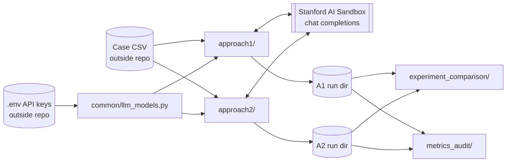

# Architecture

Snapshot of the code as of 2026-10-22 (HEAD `427e1fd` on `main`). Derived from
reading source only; nothing was executed. Where intent is inferred, it says so.

## 1. System context



```
 Case CSV ──┬─> approach1/ ──(few-shot JSON predictions)──> A1 run dir ──┐
            │        ↕ Stanford AI Sandbox (via common/)                 ├─> experiment_comparison/
            └─> approach2/ ──(extraction → lexicon → ML)──> A2 run dir ──┤
                     ↕ Stanford AI Sandbox (via common/)                 └─> metrics_audit/
```

Neither pipeline reads the other's outputs. The two post-hoc tools read saved
outputs only and never call the API.

## 2. Components

| Component | Responsibility | Key modules |
|-----------|----------------|-------------|
| `common/` | Model registry (`gpt-5-nano` → `SANDBOX_API_KEY`, `gpt-5` → `NEW_SECUREGPT_API_KEY`, per-1M-token prices), `.env` loading, reasoning-effort normalization (default `medium`; `none` omits the field), generic case-level percentile bootstrap, cost comparison helpers | `llm_models.py`, `reasoning_effort.py`, `bootstrap_cis.py`, `cost_comparison.py` |
| `approach1/` | Few-shot LLM prediction per shot set × modality tier, JSON validation, resume, evaluation | see §3 |
| `approach2/` | Nested resampling: train-only LLM extraction → stable lexicon → frozen recoding → feature matrices → sklearn models → reports | see §4 |
| `approach2/extraction/` | The LLM extraction layer (also runnable standalone via `approach2_aux.py`): API client config, per-case checkpoints, quote validation | `pipeline.py`, `schema.py`, `data.py`, `config.py` |
| `experiment_comparison/` | YAML-configured discovery of run dirs → metric extraction → normalization → plots → HTML | `run_comparison.py`, `load_config.py`, `discover_results.py`, `extract_metrics.py`, `normalize_results.py`, `plot_comparisons.py`, `generate_report.py` |
| `metrics_audit/` | Offline combined-modality A1 vs A2 metrics with bootstrap CIs; headline A2 models fixed in code | `compute_unified_metrics.py` |
| `scripts/` | Flowchart PNG renderers, offline A1 bootstrap, `unified_combined_modality_eval.py` (overlaps with `metrics_audit/`) | |

## 3. Approach 1 internals

Call graph for a normal run (`approach1/cli.py:main`):

```
main
 ├─ configure_api(env_path, model, api_version, reasoning_effort)     api/
 ├─ load_cases(csv)                          data.py      (checks required columns, synthesizes case_id)
 ├─ build_run_configs(df, outdir, shot_sets) splits.py    (one RunConfig per shotset × tier)
 │    ├─ validate_shot_rows / validate_training_modality_availability
 │    ├─ build_training_block(...)           prompts/templates.py
 │    └─ test set = all rows − exemplar rows − (MRI-missing rows if tier needs MRI)
 ├─ confirm_before_full_run (a-priori cost; -y skips)    api/cost.py
 ├─ preflight_check (unless --skip-preflight)
 ├─ for rc in run_configs: run_one_config(rc)            orchestration.py
 │    ├─ load_completed_config_checkpoint → skip if fingerprint matches   checkpoint/
 │    ├─ for each test case not already in JSONL:
 │    │     predict_case → build_user_prompt → call_securegpt_chat        inference.py
 │    │       → extract_json_from_text → sanitize (repair/drop quotes)
 │    │       → validate_prediction_obj (retry ≤ MAX_RETRIES=3)           schema/prediction.py
 │    │     append to predictions_testing_cases.jsonl
 │    ├─ write predictions CSV, token_cost_report.json
 │    ├─ evaluate_and_plot → metrics, plots, evidence attribution, bootstrap CIs   evaluation/
 │    └─ save COMPLETED.json
 ├─ save_aggregate_summary → all_tiers_metrics_summary.csv
 └─ build_approach1_results_html → approach1_results_report.html
```

Output layout: `<outdir>/<shotset_name>/<modality>/…` plus root-level aggregate
files and `run.log`.

## 4. Approach 2 internals

Call graph for a normal run (`approach2/cli.py:main`):

```
main
 ├─ load_cases → ensure_case_id → get_target_frame        eval_data.py
 │     (drops rows with missing/non-numeric dispersion; relapse may stay NaN)
 ├─ build_outer_splits (repeated_mc | stratified_kfold) + validate_outer_splits   splits.py
 ├─ a-priori cost estimate + confirm; preflight_check; write ontology + methodology.md
 ├─ for each outer split (optionally in parallel threads): run_one_outer_split   orchestration.py
 │    ├─ resume: reload manifest / COMPLETED.json if fingerprint matches          checkpoint.py
 │    ├─ write_split_provenance
 │    ├─ for mode in [mri, path] (optionally parallel): run_outer_split_for_modality
 │    │     ├─ extract_subset_records(train rows only; MRI-missing skipped for mri)   extraction/
 │    │     ├─ explode_phrase_rows → normalized phrase table                     features/normalize.py
 │    │     ├─ build_stable_lexicon_from_training_extractions (inner rediscovery) lexicon.py
 │    │     ├─ recode_cases_with_frozen_lexicon(train + test)                    recoding.py
 │    │     ├─ build_group_feature_matrix / build_phrase_feature_matrix          features/matrices.py
 │    │     └─ (mri) compute_mri_audit_table                                     audit.py
 │    ├─ if pathology calibration: reliability → weighted MRI lexicon → weighted matrix   calibration.py
 │    │     (+ optional randomized / mismatched-pairing ablations)
 │    ├─ for dataset × representation × model × target:
 │    │     filter_missing_mri_for_dataset → prepare_task_frames → should_skip_model_fit
 │    │     → fit_one_outer_model (GridSearchCV on outer-train) → predict outer-test   models_ml.py
 │    ├─ if teacher-student: fit_teacher_student_mri_model                           models_ml.py
 │    └─ save COMPLETED.json (or FAILED.json on exception)
 ├─ concatenate per-split tables; deduplicate_outer_predictions (mean over repeats)
 ├─ compute_metrics_from_predictions (+ bootstrap CIs) → nested_outer_metrics_summary.csv
 ├─ feature rankings, sign stability, relapse split diagnostics, relapse permutation tests,
 │  pathology-only-on-MRI-complete subset metrics
 └─ generate_all_reports → automated_results / interpretability / missed_case HTML + MD   reports.py
```

Output layout: `<out_dir>/outer_splits/outer_split_NNN/{mri,path}/…` per split,
plus root-level aggregate CSVs, plots and reports.

### Dataset keys produced per split

| `dataset_key` | Inputs | Notes |
|---------------|--------|-------|
| `mri` | MRI group/phrase matrices | MRI-missing cases dropped |
| `path` | Pathology group/phrase matrices | all target-eligible cases kept |
| `combined` | Early fusion: `mri__*` + `path__*` columns | MRI-missing cases dropped |
| `mri_pathcal_weighted` | Pathology-calibrated weighted MRI concept scores | on by default (`--enable-pathology-calibration`) |
| `mri_pathcal_weighted_random_pathology`, `…_mismatched_pairing` | Ablations | only with `--run-calibration-ablations` |
| `mri_teacher_student` | MRI `group_status` inputs, multi-output ridge | on by default (`--enable-teacher-student`) |

## 5. Shared contracts

- **Input schema** (both loaders): `preop_MRI_text`, `path_report_text`,
  `index_side`, `dispersion_invasive_DCIS_geographic`, `relapse`; optional
  `case_id` (else `row_{i}`). `row_index` is the 0-based position in the raw CSV.
- **Targets:** `dispersion_true` (float), `dispersion_true_high_low` (1 if ≥ 85),
  `relapse_true` (0/1).
- **Missing report text:** empty, NaN, or a placeholder (`na`, `n/a`, `nan`,
  `none`, `null`, `missing`, `not available`, …) counts as absent.
  Approach 1: `text_utils.has_report_text`. Approach 2: `extraction._is_missing_text`.
- **API:** `requests` POST to the Sandbox Azure-OpenAI chat-completions
  endpoint, `max_completion_tokens` (default 16000), `reasoning_effort` when
  set, no `temperature`. Cost is tracked from response `usage`, with cached
  input billed at the cached rate.
- **Resume fingerprints:**
  - Approach 1 (`checkpoint/fingerprint.py`): shot set, rows, tier, test row
    indices, skipped rows, `RESUME_SCRIPT_VERSION` (`approach1-3-v2`).
  - Approach 2 (`checkpoint.py`): CSV path, outer scheme/repeats/frac/folds,
    seed, stability threshold, feature cap, modalities, representations,
    model, reasoning effort, `RESUME_SCRIPT_VERSION` (2).

## 6. Configuration surface

| Where | What |
|-------|------|
| `approach1/config.py` | `CSV_PATH`/`OUT_DIR`/`ENV_PATH` defaults, `SHOT_SETS`, `MODALITY_TIERS`, `DISPERSION_HIGH_THRESHOLD`, retries/timeouts, bootstrap defaults |
| `approach1/cli.py` | Flags: `--csv-path --outdir --model --reasoning-effort --shotsets --resume --skip-completed-configs --force-rerun-cases --results-report-only --bootstrap-n --bootstrap-seed -y` |
| `approach2/config.py` | Ontology (`SHARED_CONCEPT_ONTOLOGY`, 16 concepts with regexes), negation/uncertainty regexes, `RANDOM_SEED=17`, threshold, `DEFAULT_STABILITY_THRESHOLD` |
| `approach2/cli.py` | ~45 flags. The argparse defaults are authoritative (see PIPELINE_GUIDE §4–5) |
| `approach2/extraction/config.py` | Extraction API config, `REPORT_CONFIG` (mri → `preop_MRI_text`, path → `path_report_text`) |
| Env vars | `SANDBOX_API_KEY`, `NEW_SECUREGPT_API_KEY`, `SANDBOX_ENV_PATH`/`ENV_PATH`, `MAX_COMPLETION_TOKENS`, `REASONING_EFFORT` |
| `experiment_comparison/configs/*.yaml` | Run dirs to compare (relative paths outside the repo) and output dir |

Hardcoded absolute paths outside the repo exist in `approach1/config.py`,
`approach2/extraction/config.py`, `common/llm_models.py`, the usage docstrings
of `approach1.py` / `approach2.py`, and the defaults of `metrics_audit/` and
`scripts/unified_combined_modality_eval.py`. Pass explicit paths on the CLI.

## 7. Concurrency (Approach 2)

- `--parallel-fold-workers`: outer splits run in a `ThreadPoolExecutor`.
- `--parallel-modality-workers`: mri/path extraction within a split.
- `--max-api-workers`: global semaphore on API calls across all threads.
- `--ml-n-jobs`: GridSearchCV threading backend.
- `coordinate_parallelism` lowers `ml_n_jobs` when the requested slots exceed the CPU count.

Each split writes only under its own directory and returns local tables, so
there is no shared mutable state across folds.
