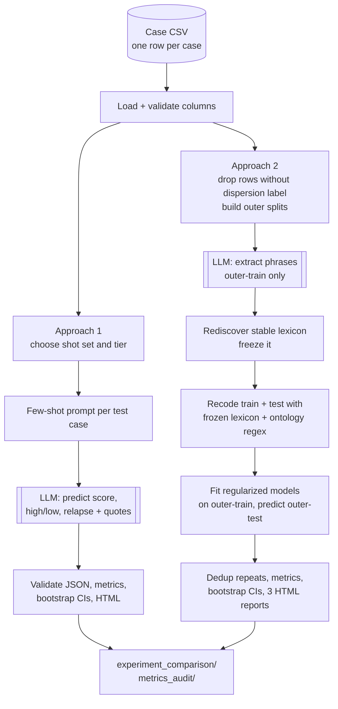
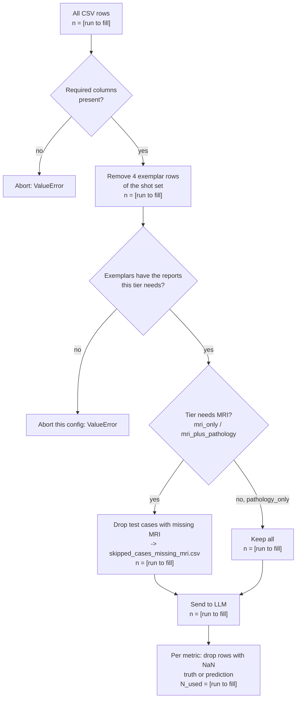
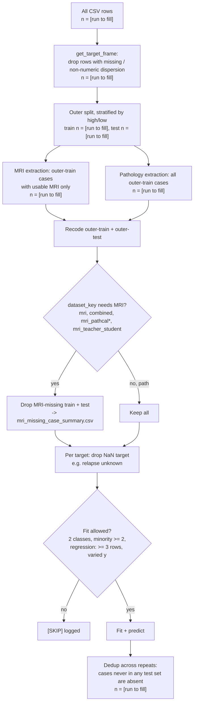
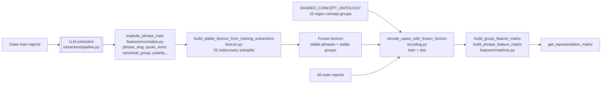
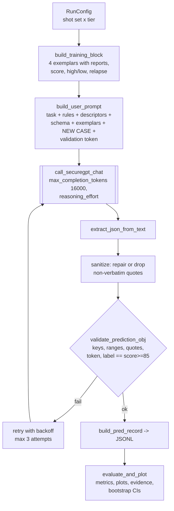
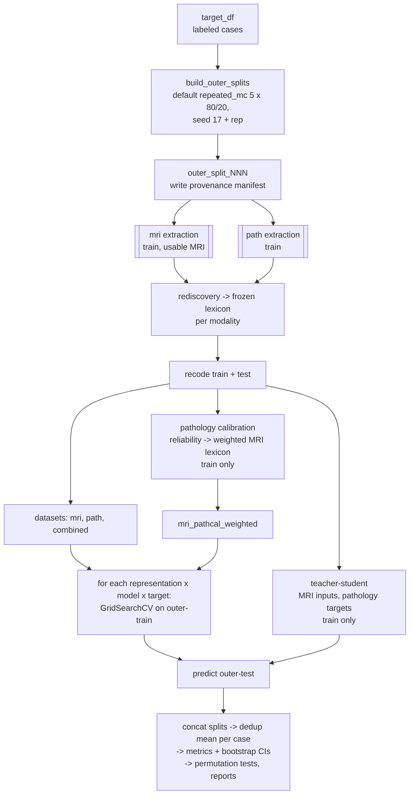
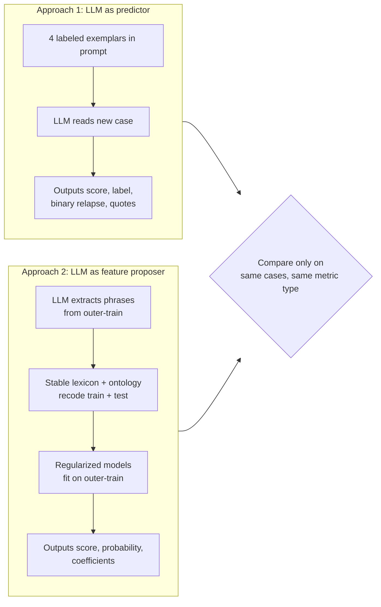
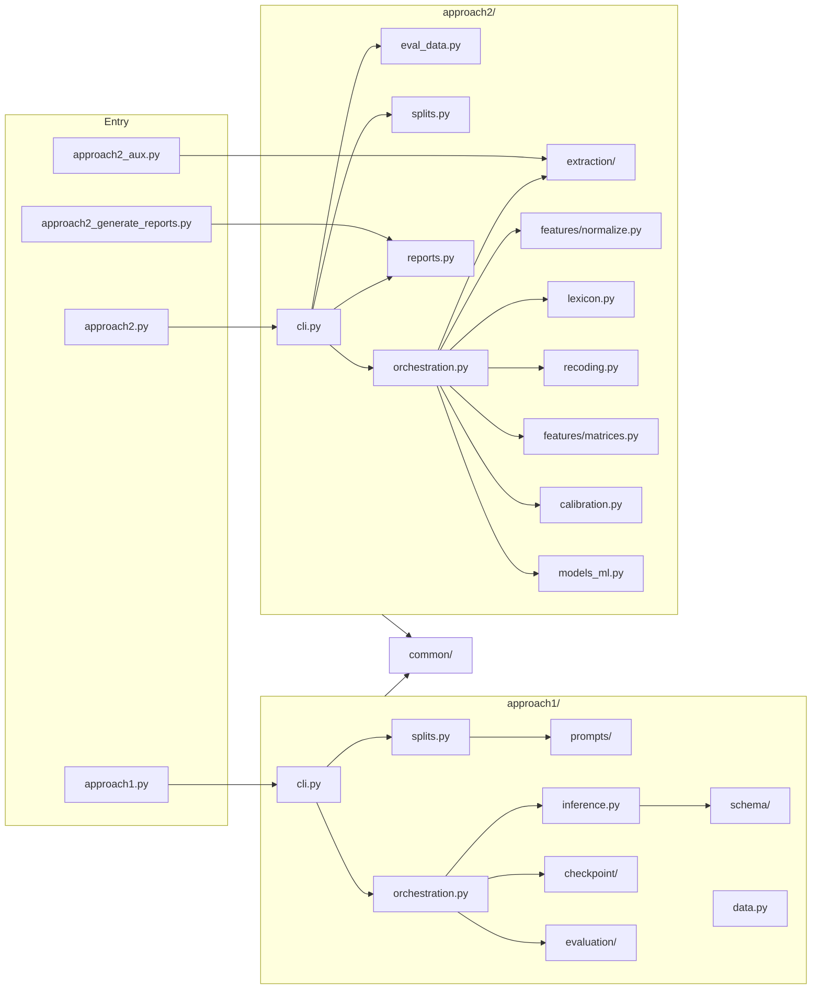

# Pipeline Guide: A Beginner's Walkthrough

For someone new to this codebase and to the statistics in it. After reading it
you should know what the pipeline does, why each step exists, where the code
lives, and where the work stands.

Each topic is explained at three levels:

- **Conceptual:** what the step is for and why it exists.
- **Intuitive:** plain-language analogies and *made-up toy numbers*. No real data appears anywhere in this guide.
- **Technical:** file, function, inputs/outputs by schema, key parameters.

Written 2026-10-22 from reading the source only (HEAD `427e1fd`). Nothing was
run. Statements marked **(inferred)** are my reading of intent, not documented
facts. Counts are placeholders: `n = [run to fill]`.

---

## 0. The big picture

**Conceptual.** After chemotherapy and before surgery, a breast tumor may have
shrunk into one compact lump or broken up into scattered islands. That
*spatial dispersiveness* matters for surgery and possibly for relapse risk.
It is measured from pathology (the ground-truth score), but radiologists and
pathologists also *describe* it in words in their reports. The question this
repo asks is: **can we predict dispersion, and relapse, from report text alone?**
It tries two very different ways and compares them.

**Intuitive.** Think of two students preparing for an exam on "is this tumor
scattered?":

- **Approach 1** is a well-read student who sees four worked examples and then answers each new question directly.
- **Approach 2** is a methodical student who first builds a glossary of tell-tale phrases from the practice set, then trains a simple scoring rule on those phrases, and only then sits the exam.

**End-to-end flow**



```
                      Case CSV (one row = one case)
                                 |
                       load + validate columns
                 +---------------+----------------+
                 |                                |
         APPROACH 1                         APPROACH 2
  shot set x tier selection        drop unlabeled rows, outer splits
  few-shot prompt per case         LLM extraction (outer-train only)
  LLM -> score/label/relapse       stable lexicon -> freeze
  validate JSON                    recode train+test (no LLM on test)
  metrics + bootstrap + HTML       sklearn models -> outer-test preds
                 |                 dedup, metrics, bootstrap, reports
                 +---------------+----------------+
                                 |
               experiment_comparison/ , metrics_audit/
```

---

## 1. The data

**Conceptual.** Each case is one patient's index breast, with two free-text
reports and two outcomes. The text is the input and the outcomes are the
targets. The data lives outside this repo and contains PHI; the code is the
only description of it used here.

**Intuitive.** One row looks like this (entirely invented):

| case_id | preop_MRI_text | path_report_text | index_side | dispersion_invasive_DCIS_geographic | relapse |
|---|---|---|---|---|---|
| TOY_01 | "…patchy non-mass enhancement…" | "…scattered residual foci…" | left | 140.0 | 1 |
| TOY_02 | "…single 1 cm residual mass…" | "…one focus, margins clear…" | right | 20.0 | 0 |
| TOY_03 | "NA" | "…minimal residual disease…" | left | 60.0 | 0 |

TOY_03 has no usable MRI report. Section 2 explains what happens to such rows.

**Technical.**

- Loaders: `approach1/data.py:load_cases` (raises if a required column is missing) and `approach2/extraction/data.py:load_cases` + `approach2/eval_data.py:get_target_frame`.
- Required columns: `preop_MRI_text`, `path_report_text`, `index_side`, `dispersion_invasive_DCIS_geographic`, `relapse`. `case_id` is optional; if absent it becomes `row_{i}`.
- Derived fields:
  - `row_index`: 0-based raw CSV position.
  - `dispersion_true`: float.
  - `dispersion_true_high_low`: 1 if ≥ 85.
  - `relapse_true`: int, may be NaN.
- Unit of analysis: **one row = one case** (one patient, one index breast). **(inferred)** One patient = one row. Nothing in the code de-duplicates patients, so if a patient could appear twice (e.g. bilateral disease), that would be a leakage risk worth checking.
- What the dispersion score *is* (units, how it was measured) is not documented in code. Approach 1 prompts constrain predictions to [0, 450].
- The input CSV path is hardcoded as a default in `approach1/config.py` and `approach2/extraction/config.py` (outside the repo). Pass `--csv-path` explicitly.

---

## 2. Filtering and cleaning

**Conceptual.** Not every case can be used in every analysis. A case without
an MRI report cannot inform an MRI-only model, and a case without a label
cannot be scored. Rules exist to drop such cases *explicitly*, with counts,
instead of silently treating missing text as "no findings".

**Intuitive.** If TOY_03's missing MRI were encoded as "zero suspicious
phrases", a model would read it as "MRI looked clean → probably low
dispersion". That is wrong: the report is absent, not clean. So TOY_03 is
excluded from MRI pathways and kept for pathology-only ones.

### 2a. What counts as "missing report text"

Empty, NaN, or a case-insensitive placeholder: `nan`, `none`, `null`, `na`,
`n/a`, `missing`, `<na>`, `not available`, `not applicable`
(`approach1/text_utils.py:_MISSING_REPORT_PLACEHOLDERS`; Approach 2 uses
`approach2.extraction._is_missing_text`, which is equivalent in intent).

### 2b. Approach 1 cascade (per shot set × tier)



```
All CSV rows                                   n = [run to fill]
  -> required columns present? (else abort)
  -> remove 4 exemplar rows                    n = [run to fill]
  -> exemplars have this tier's reports? (else abort config)
  -> tier needs MRI?
       yes: drop MRI-missing test cases        n = [run to fill]
       no (pathology_only): keep all           n = [run to fill]
  -> LLM prediction for every remaining case
  -> per metric: drop NaN truth/prediction     N_used = [run to fill]
```

Code: `approach1/splits.py:build_run_configs`, `validate_shot_rows`,
`validate_training_modality_availability`;
`approach1/evaluation/metrics.py` (per-metric NaN masks).

### 2c. Approach 2 cascade (per outer split)



```
All CSV rows                                          n = [run to fill]
  -> drop rows with missing/non-numeric dispersion    n = [run to fill]
  -> outer split (stratified on high/low)             train/test n = [run to fill]
  -> MRI extraction: outer-train with usable MRI only
     pathology extraction: all outer-train
  -> recode outer-train + outer-test
  -> dataset needs MRI? drop MRI-missing (train and test)
  -> per target: drop NaN target (e.g. unknown relapse)
  -> skip fit if 1 class / minority < 2 / too few rows
  -> dedup across repeated-MC test sets               n = [run to fill]
```

Code: `approach2/eval_data.py:get_target_frame`, `filter_missing_mri_for_dataset`,
`dataset_requires_mri_report`; `approach2/orchestration.py:run_outer_split_for_modality`
(MRI extraction skip); `approach2/models_ml.py:prepare_task_frames`,
`should_skip_model_fit`; `orchestration.py:deduplicate_outer_predictions`.

### 2d. Rules that look questionable or inconsistent

1. **Different label filtering.** Approach 2 drops unlabeled-dispersion rows *before* anything else. Approach 1 sends them to the LLM (API cost) and only masks them at metric time. The two approaches therefore start from different cohorts.
2. **Tiers in Approach 1 are not on the same cases.** `pathology_only` includes MRI-missing cases; the MRI tiers do not. Comparing tiers head-to-head mixes "modality effect" with "case-mix effect". Approach 2 does produce a matched check, `pathology_only_mri_complete_subset_metrics.csv`; Approach 1 has no equivalent.
3. **Exemplars are chosen by row position** (`iloc`), not by `case_id`. If the CSV is re-sorted or re-exported, different patients silently become exemplars. The resume fingerprint stores row numbers, not IDs.
4. **Exemplar band label comes from row membership, not the score.** `exemplar_dispersion_band` says "high" for any row in `high_rows`, while `dispersion_high_low_true` in the same block is computed from the score. If a "high" row scored < 85, the prompt would contradict itself. Unverified; see PROGRESS.md for the check command.
5. **Outer splits are stratified on dispersion high/low only.** Relapse balance per split is only reported after the fact (`relapse_class_balance_by_split.csv`), not enforced.
6. **Approach 2 recoding ignores `index_side`.** Approach 1 tells the LLM to ignore the opposite breast. Approach 2's regex/substring recoding scans the whole report, so contralateral findings can create features. The LLM extraction records `laterality`, but that field is not used downstream.
7. **Negation/uncertainty window is ±80 characters, checked by regex.** It can pick up a "no" from a neighboring sentence and mark an affirmed finding as negated. Phrase recoding also only checks the *first* occurrence of a phrase.

---

## 3. Feature construction (Approach 2; Approach 1 has none)

**Conceptual.** Models need numbers. Approach 2 turns text into columns in
two stages: (1) learn *which* words matter, using only training cases, and
(2) apply that fixed vocabulary to every case with deterministic rules. Fixing
the vocabulary before looking at test cases is what keeps the evaluation
honest.

**Intuitive.** Imagine 10 training reports. The LLM highlights phrases like
"patchy enhancement" (seen in 6 reports), "scattered foci" (4), and
"cystic change" (1). Then 25 times, take a random 80% of those 10 reports and
ask "does this phrase appear in at least 2 of them?":

| phrase | times it passed (of 25) | selection frequency | stable at 0.60? | stable at 0.20? |
|---|---|---|---|---|
| patchy enhancement | 25 | 1.00 | yes | yes |
| scattered foci | 22 | 0.88 | yes | yes |
| cystic change | 0 | 0.00 | no | no |

Stable phrases become columns. Then every report, train and test, is scanned
for each stable phrase. TOY_01 gets `patchy enhancement = 1` and TOY_02 gets
`0`. Separately, each of the 16 ontology concepts (e.g. `multiplicity`) is
matched by regex and counted, including how many matches were negated or hedged.

**Technical.**



```
outer-train reports -> LLM extraction -> explode_phrase_rows (phrase table)
   -> 25 rediscovery subsplits -> selection frequency -> frozen lexicon
ontology (16 regex groups) ----------------------------+
frozen lexicon ----------------------------------------+-> recode ALL outer cases
                                                          -> group / phrase matrices
                                                          -> representation columns
```

- **Extraction** (`approach2/extraction/pipeline.py:extract_case_features`, prompt in `approach2/prompts/builder.py`):
  - Per case and modality it returns `seed_aligned_phrases` and `denovo_candidate_phrases`. Each item has `quote`, `normalized_phrase`, `concept`, `candidate_concepts`, `polarity`, `certainty`, `laterality`, `span_type`, `section`, `directness`, `biological_ambiguity`, `mapping_confidence`, `directly_asserts_tumor`, `imaging_pattern_only`.
  - It also returns `quantitative_attributes` and `report_level_summary`.
  - Quotes must be exact substrings; ≤ 35 words, 25 targeted (`extraction/schema.py`). The prompt text separately says "≤ 30 words", a minor inconsistency.
  - **Not used as model features:** `quantitative_attributes`, `report_level_summary`, and per-phrase `laterality`/`section`/`directness`. They are paid for but only informational.
- **Normalization** (`explode_phrase_rows`):
  - Each phrase is mapped to a `canonical_group`: the first ontology concept that matches the LLM's `candidate_concepts` or the regexes, else `other_candidate_feature`.
  - Polarity and certainty are re-checked with regexes.
- **Rediscovery** (`lexicon.py:build_stable_lexicon_from_training_extractions`):
  - For each subsplit (default `--rediscovery-scheme repeated_mc`, `--rediscovery-repeats 25`, `--rediscovery-test-frac 0.20`), a phrase "passes" if it appears in ≥ `--min-phrase-cases` (2) cases of the subset; groups use `--min-group-cases` (2).
  - `selection_frequency = passes / n_subsplits`, and the phrase is stable if that is ≥ `--stability-threshold`.
  - Optional cap: `--target-stable-features-per-modality` (0 = no cap).
  - **Note:** stability is about *recurrence*, not about association with the label. Labels are used only to stratify the subsplits. It is effectively a robust prevalence filter.
- **Recoding** (`recoding.py:recode_cases_with_frozen_lexicon`):
  - For stable phrases: normalized substring search, then a ±80-char context check classifies the hit as present, negated or uncertain.
  - For groups: every regex match is counted and classified.
  - With the default `--ontology-groups-mode stable_plus_ontology`, **all 16 ontology groups are recoded whether or not they were stable**. **(inferred consequence)** The `group_*` representations are therefore driven almost entirely by the fixed regexes, and only `phrase_binary` depends on what the LLM discovered.
- **Matrices** (`features/matrices.py`). Column naming:
  - `grp__<concept>__present|count|negated_count|uncertain_count`
  - `phr__<slug>__present`
  - for `combined`, an `mri__`/`path__` prefix
- **Representations** (`get_representation_matrix`):

| representation | columns |
|---|---|
| `group_binary` | `grp__*__present` |
| `group_count` | `grp__*__count` |
| `group_status` | present + negated_count + uncertain_count |
| `phrase_binary` | `phr__*__present` |
| `weighted_concept_score` | `wgrp__*` (pathology-calibrated MRI scores) |
| `weighted_plus_group_status` | both of the above |

- **Inside each model pipeline:** `SimpleImputer(median)` → `LowInfoFeatureFilter` → `StandardScaler` → estimator, all fit on outer-train only.

---

## 4. Approach 1: few-shot LLM prediction

### Conceptual

Large language models can do "in-context learning". Show them a few solved
examples and they will try to solve a new one the same way. Approach 1 tests
whether that alone, with no training, can predict dispersion and relapse. Its
appeal is simplicity and explanations (verbatim quotes). Its weaknesses: only
4 examples, outputs that are not true probabilities, and no learned weights to
inspect.

### Intuitive

You hand a clinician four annotated cases, say TOY_A "score 140, high,
relapsed", TOY_B "score 110, high, no relapse", TOY_C "score 30, low, no
relapse" and TOY_D "score 15, low, no relapse", each with its reports. Then
you give them a new report and ask for a score, a high/low call, a relapse
call, and the quotes that convinced them. For example: "score 95 → high;
relapse 0; quotes: 'patchy non-mass enhancement', 'scattered residual foci'".

### Technical



```
RunConfig (shot set x tier)
  -> build_training_block (4 labeled exemplars)
  -> build_user_prompt (instructions, descriptors, JSON schema, exemplars, new case, token)
  -> LLM call -> parse JSON -> repair/drop quotes -> validate
       (fail -> backoff retry, max 3; then RuntimeError)
  -> append record to predictions_testing_cases.jsonl
  -> after all cases: CSV, metrics, plots, bootstrap CIs, COMPLETED.json
```

- **Shot sets** (`approach1/config.py:SHOT_SETS`): `shotset_high_0_2_low_101_102` and `shotset_high_0_19_low_82_85`. Values are raw CSV row numbers.
- **Tiers:** `mri_only`, `pathology_only`, `mri_plus_pathology`. In single-modality tiers the other report shows as `<NOT PROVIDED IN THIS TIER>`.
- **Prompt** (`prompts/templates.py:build_user_prompt`, `system.py`, `descriptors.py`):
  - Asks for `dispersion_score_pred` in [0, 450], `dispersion_high_low_pred`, `relapse_pred`, ≤ 6 verbatim `key_evidence` quotes, `retrieval_check_token_returned`/`retrieval_check_correct`, `reasoning_summary`, and a 5-step `structured_rationale`.
  - Includes a hand-written list of "dispersiveness descriptors" as guidance.
- **Validation** (`schema/prediction.py`): `dispersion_high_low_pred` **must equal** `int(score >= 85)`, otherwise the response is rejected and retried.
- **Outputs per config:** `predictions_testing_cases.{jsonl,csv}`, `run_config.json`, `skipped_cases_missing_mri.csv`, `token_cost_report.json`, `evaluation_metrics_summary.json`, `evaluation_metrics_from_csv.txt`, `bootstrap_metric_cis.{csv,json}`, plots, `evidence_attribution_*.csv`.

### Assumptions

- The 4 exemplars are representative. There is no averaging over many exemplar draws; the two shot sets are a minimal sensitivity check.
- The LLM uses only the supplied text. The system prompt asks for this, but it cannot be enforced.
- One sample per case is enough. There is no `temperature` control and no repeated sampling, so reruns may differ.

### How to read the outputs, and common misreadings

- **High/low accuracy and F1** come from `dispersion_high_low_pred`. Because validation forces that label to equal `score ≥ 85`, they are just the score thresholded at 85.
- **High/low AUROC/AUPRC** rank the continuous `dispersion_score_pred`. These are legitimate ranking metrics.
- **Relapse AUROC/AUPRC rank a binary 0/1 label.** With binary scores, AUROC = (sensitivity + specificity) / 2 = balanced accuracy. It is *not* comparable to an AUROC computed from probabilities (Approach 2).
  - Toy example: sensitivity 0.6 and specificity 0.7 give "AUROC" 0.65 no matter how confident the model was.
- `relapse_predictor_comparison`: (B) uses the *predicted dispersion score* as a relapse risk score. (C) uses the *true* dispersion score as an upper-bound signal check; it is not a model.
- **Evidence attribution:** n-grams from the quotes, with smoothed odds ratios by *predicted* class. It shows what the model cites, not what predicts truth.
- **Needle rate** below 1.0 means the model sometimes failed to echo the validation token, a context-attention warning. It is not a clinical metric.

---

## 5. Approach 2: nested lexical discovery + supervised ML

### Conceptual

Instead of trusting the LLM's judgment, use it only as a *reader* that
proposes candidate phrases. Then learn, with classical statistics, how much
each phrase matters. Wrap everything learned from data inside an outer
train/test split so the test cases never influence anything. This gives
probabilities, coefficients you can inspect, and a cleaner leakage story, at
the price of many more moving parts.

### Intuitive

Back to the glossary-building student. For each practice exam (outer split):
build the glossary from the practice questions only; turn every question,
practice and real, into a checklist of glossary terms; fit a simple weighted
scoring rule on the practice checklist; then score the real questions with it.

### Technical



```
target_df -> outer splits (5 x stratified 80/20, seeds 17..21)
  for each split:
    extraction (train only; mri skips missing-MRI) -> frozen lexicon per modality
    recode train+test -> datasets mri / path / combined
    [default on] pathology calibration -> mri_pathcal_weighted
    [default on] teacher-student -> mri_teacher_student
    every dataset x representation x model x target: GridSearchCV(train) -> predict(test)
  concat -> dedup (mean per case) -> metrics + bootstrap CIs -> reports
```

**Models** (`models_ml.py:get_model_specs`, `build_pipeline_and_grid`):

| key | task | estimator | grid | inner-CV scoring |
|---|---|---|---|---|
| `ridge_logistic` | classification | LogisticRegression L2, balanced | C ∈ {0.01…100} | ROC AUC |
| `elasticnet_logistic` | classification | LogisticRegression EN (saga), balanced | C × l1_ratio | ROC AUC |
| `linear_svm` | classification | SVC linear, `probability=True`, balanced | C | ROC AUC |
| `ridge_regression` | regression | Ridge | alpha | −MAE |
| `elasticnet_regression` | regression | ElasticNet | alpha × l1_ratio | −MAE |
| `pls_regression` | regression | PLSRegression | n_components 1…≤10 | −MAE |
| `linear_svr` | regression | LinearSVR | C × epsilon | −MAE |
| `huber_regression` | regression | HuberRegressor | alpha × epsilon | −MAE |

- **Targets:** each classifier is fit twice, for `dispersion_high_low` and `relapse_status`. Regressors predict `dispersion_score`.
- **Inner CV:** stratified k-fold (classification) or k-fold (regression), with k = min(5, minority count or n), at least 2.
- **Classification threshold:** `y_pred = y_prob ≥ 0.5`.

**Pathology calibration** (`calibration.py`; default on, `--enable-pathology-calibration`):

- On outer-train cases that have MRI, measure how often each MRI concept co-occurs with each pathology concept (smoothed Δp, lift, MI).
- Weight each MRI concept by stability^0.5 × concordance^1.0 × (1 + |Spearman with dispersion|)^0.5, with an ambiguity penalty (0.55 for `benign_or_nonspecific_enhancement`) and a low-prevalence penalty.
- Features are `weight × status`, where status = present + 0.5·uncertain + 0·negated by default.
- **(Questionable)** `--weighted-lexicon-min-selection-frequency` has no effect: `stab = max(stability, min)` makes the subsequent `stab < min` check impossible.

**Teacher-student** (`models_ml.py:fit_teacher_student_mri_model`; default on):

- The teacher is a fixed ridge (α = 10) on pathology `group_status` that produces out-of-fold scores.
- The student is a multi-output ridge on **MRI-only** `group_status` features. Its targets are scaled true dispersion (λ = 1), the teacher score (λ = 0.5) and the pathology concepts (λ = 0.25).
- Test predictions use MRI only. There is no hyperparameter search.
- **Caveats:**
  - The high/low "probability" is `clip((pred − 85 + 20) / 40, 0, 1)`. That is a heuristic, not a probability, and clipping creates ties. Its Brier score and calibration are not meaningful, and its AUROC is slightly degraded by the ties.
  - The relapse head is a plain MRI logistic regression, not multitask.
  - Exceptions in this block are caught and only printed as `[WARN]`.

**Leakage boundary.** Extraction, rediscovery, lexicon, reliability, weights,
teacher, scaler, imputer and model all use outer-train only. Test cases are
only *recoded* (deterministic rules), never LLM-extracted. Unstable or novel
test wording therefore becomes zeros: under-featurization, not leakage.

### Assumptions

- Report language that recurs across training cases generalizes to new cases.
- Linear effects of phrase/concept indicators are adequate.
- The hand-written ontology regexes capture the relevant concepts. These are fixed priors.
- Averaging repeated-MC predictions yields a fair per-case estimate.

### How to read the outputs, and common misreadings

- `nested_outer_metrics_summary.csv` has one row per `dataset_key × representation × model_key × target_name`. **Always name all four** when quoting a number.
- **Many rows, one winner:** the reports highlight the best row (`_best_row`: lowest MAE; highest AUROC, or AUPRC for relapse). Picking the max over dozens of combinations on the same predictions is optimistic. Treat it as exploratory unless the model was pre-specified. The `metrics_audit/` headline models *were* pre-specified before seeing results.
- **Coefficients** are on standardized features after filtering. Sign stability across splits (`nested_feature_sign_stability.csv`) matters more than any single coefficient. They are associations, not causes.
- **Dedup coverage:** with 5 random 20% test draws, a given case lands in at least one test set with probability 1 − 0.8⁵ ≈ 0.67. So roughly a third of cases are expected to have **no** held-out prediction, and headline metrics cover only the rest.
  - Toy example: 100 cases → about 67 scored.
  - Use `--outer-scheme stratified_kfold` for one-prediction-per-case coverage.
- **AUPRC** must be compared to its no-skill baseline (`auprc_no_skill_baseline` = prevalence).
- **Relapse permutation p-values** (`relapse_permutation_tests.csv`) are per model and uncorrected for the number of models tested.

---

## 5b. Approach 1 vs Approach 2 side by side



```
APPROACH 1 (LLM predicts)                 APPROACH 2 (LLM proposes features)
-------------------------                 ----------------------------------
4 labeled exemplars in prompt             LLM extracts phrases from outer-train
LLM reads each test case                  stable lexicon + ontology -> recode all
-> score, label, binary relapse, quotes   regularized models fit on outer-train
                                          -> score, probability, coefficients
                 \                         /
                  compare only on same cases, same metric type
```

| Aspect | Approach 1 | Approach 2 |
|---|---|---|
| Role of LLM | Makes the prediction | Proposes candidate phrases (train only) |
| Labeled data used | 4 exemplars per shot set | All outer-train cases |
| Validation design | Single held-out set (all non-exemplar rows) | Nested repeated MC (default) or stratified k-fold |
| LLM calls on test cases | Yes, every test case | No; test is recoded by rules |
| Relapse output | Binary label | Probability |
| High/low AUROC from | Predicted score | Predicted probability |
| Interpretability | Quotes + rationale text | Coefficients, lexicons, reliability tables |
| Missing MRI | Excluded from MRI tiers | Excluded from MRI-derived datasets |
| Laterality | Prompt focuses on `index_side` | Not used in recoding |
| Main risks | Exemplar choice, nondeterminism, label-based relapse AUROC | Many-model selection, dedup coverage, regex brittleness |
| Cost driver | (#test cases) × tiers × shot sets | (#outer-train cases) × modalities × outer splits (checkpoints reuse per case) |

**Why both exist (inferred).** Approach 1 is a direct "can an LLM just do
it?" baseline. Approach 2 asks whether a transparent, leakage-controlled model
on LLM-proposed features does better or is more trustworthy.

**When each is preferable.**
- Approach 1: quick feasibility, small budgets of labeled data, human-readable rationales.
- Approach 2: you need probabilities, calibration, inspectable features, or a defensible validation story.

**How to compare them correctly** (see `metrics_audit/README.md`):
- Use the same cases. The combined-modality audit found the overlap smaller than either cohort, partly from Approach 2's dedup coverage.
- Use the same metric definition. Do not put Approach 1 binary-label relapse AUROC next to Approach 2 probability AUROC as if equal.
- State N, split design, score source, and code version.
- Use pre-specified models, not the best-of rows.
- The audit's verdict is "approximately comparable, not directly comparable".

---

## 6. Evaluation and interpretation

**Conceptual.** A model is only as good as the honesty of its test. This
section lists what is measured, how uncertainty is estimated, and what the
numbers cannot tell you.

**Intuitive.** If a toy classifier gets 15 of 20 test cases right, "75%
accuracy" sounds precise. A bootstrap reshuffles those 20 cases a thousand
times and might give 55%–90%. That width is the honest message from 20 cases.

**Technical.**

- **Metrics**
  - Regression: MAE, RMSE, Spearman ρ (A1); plus R² and Pearson r (A2).
  - Classification: accuracy, F1, confusion matrix, AUROC, AUPRC (A1); A2 adds balanced accuracy, precision/PPV, recall, specificity, NPV, Brier, calibration intercept/slope, prevalence.
  - Code: `approach1/evaluation/metrics.py`, `approach2/models_ml.py:classification_metrics`, `regression_metrics`.
- **Validation**
  - A1: one held-out set per config.
  - A2: per-split metrics (`nested_outer_fold_metrics_all.csv`) plus pooled, deduplicated metrics (`nested_outer_metrics_summary.csv`).
- **Uncertainty**
  - Case-level percentile bootstrap, 1000 replicates by default: A1 seed 42 (`common/bootstrap_cis.py`), A2 seed 17 (`add_bootstrap_metric_cis`).
  - The CIs treat predictions as fixed. They do not include variability from re-splitting, re-extracting, or model selection, so they are likely too narrow.
  - A2 also runs a relapse permutation test (1000 permutations by default).
- **Limitations**
  - Internal validation only, from a single institution **(inferred)**.
  - Small N; many models, representations and tiers compared without multiplicity correction.
  - The threshold of 85 is a fixed choice with no documented clinical rationale.
  - LLM outputs are nondeterministic.
  - Regex negation is crude.
  - Results depend on model version, reasoning effort and prompt text; record all three.

---

## 7. Outputs (names and locations only)

All outputs go to the run directory you pass (`--outdir` / `--out_dir`). They
**contain report text** (quotes, rationales, context windows) and must be
treated as PHI.

**Approach 1** (`<outdir>/`)
- Root: `run.log`, `all_tiers_metrics_summary.csv`, `approach1_results_report.html`, `llm_token_cost_report.json`, cost plots (`cost_estimate_vs_actual_*.png`).
- Per `<shotset>/<tier>/`:
  - Predictions and run metadata: `predictions_testing_cases.{jsonl,csv}`, `run_config.json`, `skipped_cases_missing_mri.csv`, `token_cost_report.json`.
  - Metrics: `evaluation_metrics_summary.json`, `evaluation_metrics_from_csv.txt`, `evaluation_explanation.txt`, `bootstrap_metric_cis.{csv,json}`.
  - Plots: `dispersion_true_vs_pred_scatter.png`, `dispersion_residuals_hist.png`, `dispersion_high_low_confusion_matrix.png`, `relapse_{confusion_matrix,roc_curve,pr_curve}.png`, `predicted_dispersion_by_true_relapse.png`, `relapse_predictor_comparison.png`, `needle_retrieval_rates.png`, `evidence_features_*.png`.
  - Evidence tables: `evidence_attribution_*.csv`.
  - Resume: `_resume_checkpoint/COMPLETED.json`.

**Approach 2** (`<out_dir>/`)
- Per split `outer_splits/outer_split_NNN/`:
  - Provenance manifest.
  - Per modality `{mri,path}/`: extraction checkpoints/CSVs, `*_normalized_phrase_table_train_*.csv`, `*_phrase|group_rediscovery_frequency_*.csv`, `*_stable_phrase|group_lexicon_*.csv`, `*_stable_lexicon_metadata_*.json`, `*_phrase|group_recode_provenance_*.csv`, `*_group|phrase_feature_matrix_*.csv`, and (mri) `*_mri_audit_*.csv`.
  - Calibration: `*_mri_pathology_reliability_matrix.csv`, `*_weighted_mri_lexicon.csv`, `*_weighted_mri_concept_score_matrix.csv`.
  - Status: `COMPLETED.json` / `FAILED.json`.
- Root predictions and metrics: `nested_outer_predictions_all.csv`, `nested_outer_predictions_case_deduplicated.csv`, `nested_outer_metrics_summary.csv`, `nested_outer_fold_metrics_all.csv`, `nested_outer_hyperparameters_all.csv`, `nested_outer_feature_coefficients_all.csv`, `nested_outer_split_errors.csv`.
- Root feature summaries: `nested_feature_ranking_{classification,regression}.csv`, `nested_feature_sign_stability.csv`, `stable_*_lexicon_outer_summary.csv`, `all_outer_*.csv`.
- Root diagnostics: `mri_missing_case_summary.csv`, `cohort_report_availability_summary.json`, `relapse_class_balance_by_split.csv`, `relapse_permutation_tests.csv`, `pathology_only_mri_complete_subset_metrics.csv`, `shared_biological_concept_ontology.csv`, `nested_resampling_summary.txt`.
- Cost: `llm_cost_estimate_apriori*.json`, `llm_token_cost_report.json`.
- Reports: `automated_results_report.{html,md}`, `interpretability_report.{html,md}`, `missed_case_review.html`, `missed_case_error_analysis.{csv,md}`.
- Plot folders: `report_plots/`, `interpretability_plots/`.

**Post-hoc**
- `experiment_comparison`: `normalized_metrics_long.csv`, `summary_best_metrics.csv`, plots, `comparison_report.html`, in the config's `output_dir`.
- `metrics_audit`: `unified_metrics_long.csv`, `unified_metrics_report.md`.

---

## 8. Where things stand

As of the last commit (2026-06-29), both pipelines run end to end. Approach 1
has score-based high/low AUROC and bootstrap CIs. A cross-run comparison
framework and a pre-specified combined-modality audit exist. Nothing has been
committed since; the work is idle. Open issues and next steps are tracked in
[`docs/PROGRESS.md`](PROGRESS.md). Highest-value items:

1. Resolve the stability-threshold default (0.60 in CLI vs 0.20 elsewhere) and record which value each reported run used.
2. Decide whether `group_*` features should depend on the LLM lexicon (`stable_only`) or stay ontology-driven.
3. Make the A1 and A2 evaluation cohorts comparable (label filtering, matched cases, `stratified_kfold` for full coverage).
4. Fix the teacher-student pseudo-probability, and either surface or stop swallowing its exceptions.
5. Add the deferred golden-fold regression test (synthetic extraction fixtures).

## File / module map



```
approach1.py -> approach1/cli.py
                 ├ data.py            load CSV
                 ├ splits.py          shot sets x tiers, test sets, missing-MRI skip
                 ├ prompts/           system msg, descriptors, templates, tokens
                 ├ orchestration.py   per-config loop, aggregate summary
                 │   ├ inference.py   LLM call + retry
                 │   ├ schema/        JSON parse, quote repair, validation
                 │   ├ checkpoint/    JSONL resume, COMPLETED.json, fingerprint
                 │   └ evaluation/    metrics, bootstrap, plots, evidence, HTML
approach2.py -> approach2/cli.py
                 ├ eval_data.py       target frame, MRI-missing filters
                 ├ splits.py          outer + rediscovery splits
                 ├ orchestration.py   per-split pipeline, dedup, metrics
                 │   ├ extraction/    LLM extraction (also approach2_aux.py)
                 │   ├ features/normalize.py   phrase table, concept mapping
                 │   ├ lexicon.py     rediscovery + frozen lexicon
                 │   ├ recoding.py    substring/regex recode
                 │   ├ features/matrices.py    wide matrices, representations
                 │   ├ calibration.py pathology-informed MRI weights
                 │   └ models_ml.py   model zoo, GridSearchCV, teacher-student
                 └ reports.py         HTML/MD reports (also approach2_generate_reports.py)
common/          model registry, reasoning effort, bootstrap, cost comparison
```
