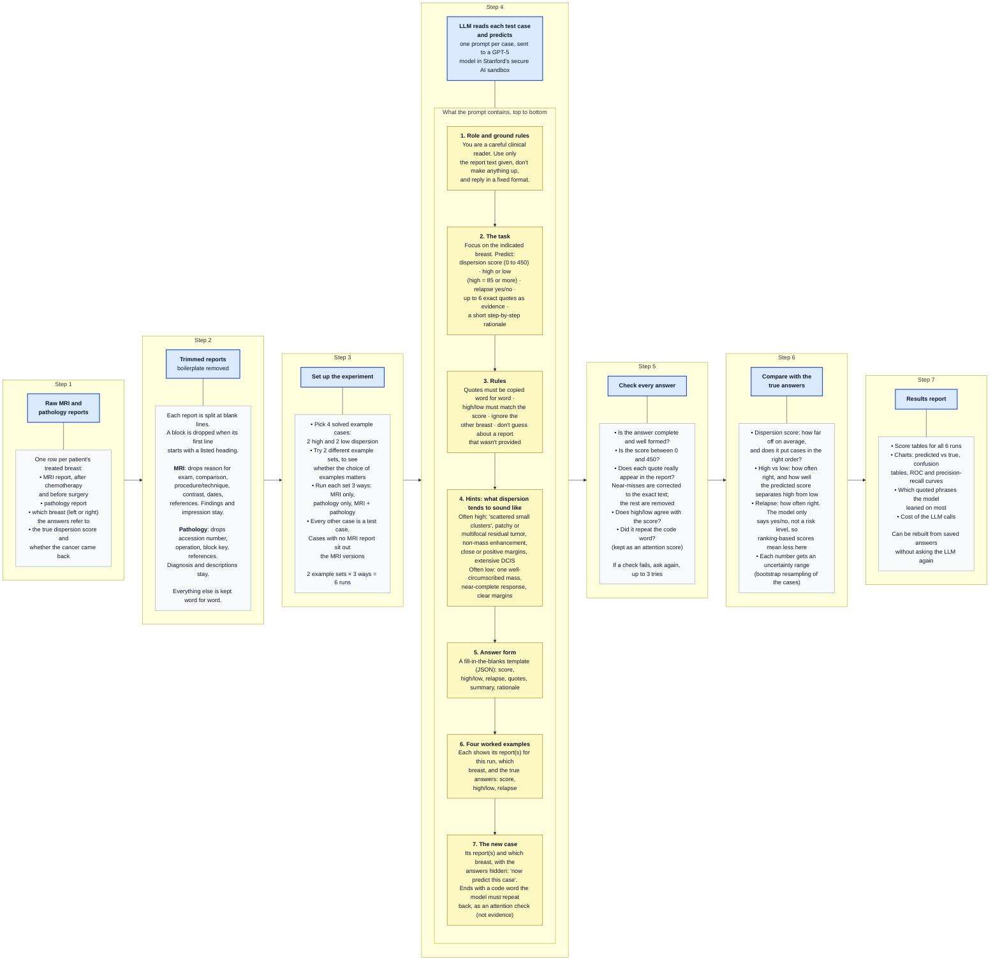

# How Approach 1 works: a one-page diagram

Written 2026-10-24 for non-technical collaborators, from reading the source code
only. Nothing was run, and no patient data was looked at. All example wording is
taken from the prompt code or invented.

**In two sentences.** We show a large language model (LLM) four solved example
cases, then give it one new patient's reports and ask it to predict how
scattered the remaining tumor is, and whether the cancer will come back. We
check each answer automatically and compare it with what actually happened.

Read left to right. The colored box at the top of each column is the step. The
box underneath explains how that step is done.



## Plain-text version

The same diagram, for viewers that do not render Mermaid.

```text
[ 1. Raw MRI + pathology reports ]
    |  one row per patient's treated breast: MRI report (after chemo, before
    |  surgery), pathology report, which breast, true dispersion score, relapse
    v
[ 2. Trimmed reports ]
    |  split at blank lines; drop a block whose first line is a listed heading
    |  MRI: drop reason for exam, comparison, procedure/technique, contrast,
    |       dates, references. Keep findings and impression.
    |  Pathology: drop accession number, operation, block key, references.
    |       Keep diagnosis and descriptions. Everything else is kept as written.
    v
[ 3. Set up the experiment ]
    |  4 solved examples (2 high, 2 low) x 2 example sets
    |  x 3 ways (MRI only / pathology only / MRI + pathology) = 6 runs
    |  every other case is a test case; no-MRI cases sit out the MRI versions
    v
[ 4. LLM reads each test case and predicts ]   (one prompt per case)
    |    [ Role and ground rules: careful clinical reader, use only the text ]
    |      -> [ Task: score 0-450, high/low (85+), relapse yes/no, quotes, rationale ]
    |      -> [ Rules: exact quotes, high/low matches score, index breast only ]
    |      -> [ Hints: wording that often means high vs low dispersion ]
    |      -> [ Answer form: fixed JSON template ]
    |      -> [ 4 worked examples: reports, breast, true score/high-low/relapse ]
    |      -> [ New case: reports + breast, answers hidden, "now predict" + code word ]
    v
[ 5. Check every answer ]
    |  complete? score in range? quotes really in the report (fix near-misses,
    |  drop the rest)? high/low agrees with score? code word repeated?
    |  failed check -> ask again, up to 3 tries
    v
[ 6. Compare with the true answers ]
    |  score error and ordering; high/low accuracy and separation;
    |  relapse accuracy (yes/no only); uncertainty ranges by bootstrap
    v
[ 7. Results report ]
       tables, charts, most-cited phrases, LLM cost
```

## What the words mean

- **Dispersion (dispersiveness):** how spread out the remaining tumor is after
  chemotherapy, from one compact lump to many scattered islands. It is measured
  as a score; 85 or more counts as "high".
- **Relapse:** whether the cancer came back.
- **Few-shot:** showing the model a few solved examples inside the prompt,
  instead of training it on data. The model's internals are never changed.
- **Index breast (index side):** the breast (left or right) the score and relapse
  label belong to. Reports sometimes describe both breasts.
- **Run / version (tier in the code):** which report or reports the model is shown.

## What this picture leaves out

- The model gives one answer per case. Asking again could give a slightly
  different answer.
- All test cases in a run see the same four examples, so results can depend on
  which examples were picked. That is why two example sets are compared.
- The MRI versions skip cases that have no MRI report, so the three versions are
  not scored on exactly the same cases.
- Long runs save every answer as they go, so a stopped run can pick up where it
  left off. This does not change the results.

## Where this lives in the code (for maintainers)

| Step | Files |
|---|---|
| 2. Trimming | `aux/trim.py` (`MRI_REMOVE_PREFIXES`, `PATH_REMOVE_PREFIXES`, `_trim_by_sections`) |
| 1, 3. Loading, example sets, runs | `approach1/data.py`, `approach1/config.py` (`SHOT_SETS`, `MODALITY_TIERS`), `approach1/splits.py` |
| 4. Prompt | `approach1/prompts/system.py`, `templates.py`, `descriptors.py`, `tokens.py` |
| 4. LLM call | `approach1/inference.py`, `approach1/api/client.py` |
| 5. Checking | `approach1/schema/prediction.py` |
| 6–7. Scoring and report | `approach1/evaluation/` (`runner.py`, `bootstrap.py`, `results_report.py`), `approach1/orchestration.py` |

For the technical version of this flow, see `docs/PIPELINE_GUIDE.md` §4 and
`docs/ARCHITECTURE.md` §3.
